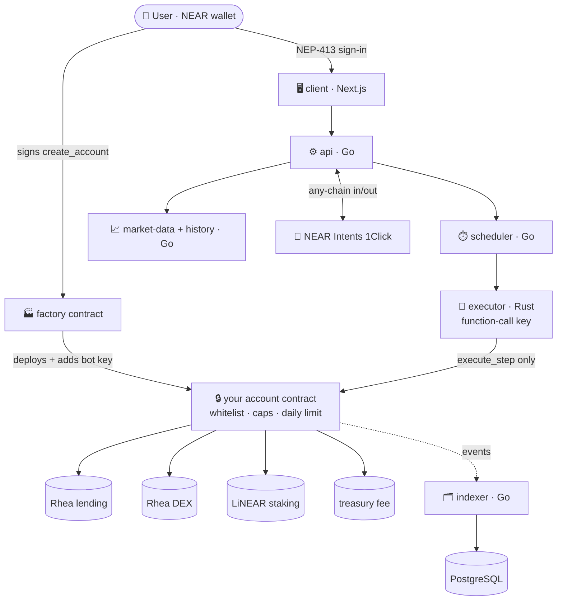

# Nearly


Nearly lets you put money into yield baskets on NEAR. You pick a mix of lending, liquidity and liquid staking. A bot runs and rebalances the basket, but it **cannot take your funds**. The rules are enforced by your own NEAR smart-contract account, not by our server.

Built at NEAR HACKATHON (2026-11-01 → 2026-11-14). Tracks: **`defi`** and **`security`**.

## For judges: check it in 2 minutes

No Docker or secrets needed for these:

```sh
scripts/verify-testnet.sh    # every deployed account exists and has code
make contracts-test          # 62 contract tests: policy, caps, daily limit, revoke, sandbox runs
```

| Track | What to look at |
|---|---|
| `defi` | Baskets across Rhea lending, the Rhea DEX and liquid staking; backtests; deposit and withdraw from any chain via NEAR Intents 1Click |
| `security` | The bot holds a function-call key limited to `execute_step`, and the contract checks each step: token whitelist, per-step cap, **daily limit**, no free-form receiver, owner kill switch |

## The problem

Automated DeFi strategies need a bot that signs transactions. Usually that means handing it your keys or depositing into a shared vault, and either way you're trusting the operator. One bug or leaked server key and the money is gone.

## What Nearly does

- **One account per user.** The factory creates `alice-testnet.factory.nearly-dev-c7dc68.testnet` (for `alice.testnet`), a contract account that only you own.
- **The bot gets a function-call key, not your keys.** That key can call exactly one method, `execute_step`, with a limited gas allowance.
- **The contract checks every step.** A step can only move whitelisted tokens into Rhea lending, the Rhea DEX, liquid staking, the treasury fee, or back to you. Each step has a cap, and each token has a daily limit. No step can name an arbitrary receiver.
- **You can switch the bot off at any time.** `revoke_executor` deletes its key on chain.
- **Deposit or withdraw from any chain** through NEAR Intents 1Click.

## Threat model: what a leaked bot key can do

| An attacker with the bot's key… | Result | Enforced at |
|---|---|---|
| sends funds to their own account | ❌ impossible: no step type has a receiver field | `contracts/account/src/step.rs:4` |
| calls any other method (`withdraw`, `set_*`, …) | ❌ the key only allows `execute_step` | `contracts/factory/src/lib.rs:104` |
| moves a non-whitelisted token | ❌ rejected | `contracts/account/src/policy.rs:28` |
| moves more than the cap in one step | ❌ `over cap` | `contracts/account/src/policy.rs:28` |
| repeats steps to drain over time | ❌ `over daily cap`: at most `daily_steps` × cap per token per UTC day (default 10) | `contracts/account/src/policy.rs:28` |
| keeps acting after you notice | ❌ `revoke_executor` deletes the key; later calls fail with `executor revoked` | `contracts/account/src/owner.rs:102` |
| spends daily-limited value through bad swaps or fees | ⚠️ possible, within the limits above (see Known limits) | — |

## How NEAR is used

| NEAR feature | Where | Why it matters |
|---|---|---|
| Sub-accounts + factory | `contracts/factory/src/lib.rs:69` `create_account` | Each user gets their own on-chain account; there's no shared vault |
| Function-call access keys | `contracts/factory/src/lib.rs:104` `add_access_key_allowance(…, "execute_step")` | The bot can call one method, with capped gas |
| On-chain policy engine | `contracts/account/src/policy.rs:15` `assert_executor`, `:28` `assert_cap`, `:53` `check_step` | Limits are enforced by the contract, not the server |
| No-receiver step type | `contracts/account/src/step.rs:4` | Fund destinations are fixed in code |
| Owner controls | `contracts/account/src/owner.rs:94` `set_daily_steps`, `:102` `revoke_executor` | The owner sets the daily limit and can remove the bot's key in one call |
| NEAR Intents 1Click | `internal/shared/intents/`, `services/api/internal/api/intents.go` | Deposit from or withdraw to other chains |
| Rhea lending + DEX, liquid staking | `contracts/deployments/testnet.json` | Where the yield comes from |
| NEP-413 sign-in | `services/api/internal/auth/` | Wallet login without passwords |
| NEAR Connect wallet | `client/` (`@hot-labs/near-connect`) | Connect an existing NEAR wallet |

## Architecture



Funds leave your account only to these venues, the treasury fee, or back to you (`to_owner`, `withdraw`).

| Path | Role |
|---|---|
| `contracts/account` | Per-user account contract: holds funds, enforces the policy on chain |
| `contracts/factory` | Creates user sub-accounts, deploys `account`, adds the bot's function-call key |
| `contracts/mocks/*` | Sandbox-only venue mocks for tests |
| `executor/` | Rust signer: turns planned steps into `execute_step` transactions; adds an off-chain USD cap (`MAX_STEP_USD`) and requires `min_out` on swaps |
| `services/api` | User API: auth, baskets, deposit/withdraw, Intents quotes, schedules |
| `services/scheduler` | DCA, recurring buys, rebalancing |
| `services/market-data` | Prices, rates, quotes, WebSocket feed |
| `services/history` | Historical rates and backtests |
| `services/indexer` | Indexes account contract events |
| `internal/shared` | Shared Go packages: config, HTTP, Postgres, NEAR RPC, planner, Intents |
| `client/` | Next.js app |
| `migrations/` | Postgres schema |

## Contract addresses (NEAR testnet)

| Role | Address | Explorer |
|---|---|---|
| Factory (ours) | `factory.nearly-dev-c7dc68.testnet` | [nearblocks](https://testnet.nearblocks.io/address/factory.nearly-dev-c7dc68.testnet) |
| Treasury (ours) | `treasury.nearly-dev-c7dc68.testnet` | [nearblocks](https://testnet.nearblocks.io/address/treasury.nearly-dev-c7dc68.testnet) |
| Root / deployer (ours) | `nearly-dev-c7dc68.testnet` | [nearblocks](https://testnet.nearblocks.io/address/nearly-dev-c7dc68.testnet) |
| User accounts (ours) | `<owner>.factory.nearly-dev-c7dc68.testnet` | one per user, created by the factory |
| Rhea lending | `burrow.services.ref-labs.testnet` | [nearblocks](https://testnet.nearblocks.io/address/burrow.services.ref-labs.testnet) |
| Rhea DEX | `ref-finance-101.testnet` | [nearblocks](https://testnet.nearblocks.io/address/ref-finance-101.testnet) |
| Liquid staking (LiNEAR) | `linear-protocol.testnet` | [nearblocks](https://testnet.nearblocks.io/address/linear-protocol.testnet) |
| USDC (test) | `usdcc.ft.ref-labs.testnet` | [nearblocks](https://testnet.nearblocks.io/address/usdcc.ft.ref-labs.testnet) |
| wNEAR | `wrap.testnet` | [nearblocks](https://testnet.nearblocks.io/address/wrap.testnet) |

Source of truth: `contracts/deployments/testnet.json`. Check with `scripts/verify-testnet.sh`; redeploy with `scripts/deploy-testnet.sh`.

## Try the app (testnet)

Prerequisites: Docker, Go 1.25+, Rust + `cargo-near`, Bun, and a NEAR testnet wallet.

```sh
cp .env.example .env          # fill EXECUTOR_*, INTERNAL_SECRET, SESSION_SECRET, NEARLY_ROOT_ACCOUNT
make up                       # postgres, redis, api, executor, scheduler, market-data, history, indexer
make smoke                    # every service answers GET /health
cd client && cp .env.example .env.local && bun install && bun run dev   # http://localhost:3000
```

Then in the app:

1. **Connect your wallet**, then sign in by signing a message (no password).
   → Nearly asks you to sign the factory `create_account` transaction. Your account (for example `alice-testnet.factory.nearly-dev-c7dc68.testnet`) appears on testnet.
2. **Go to Baskets → New** and build a mix (for example USDC lending + wNEAR staking), then click **Backtest**.
   → You see historical APY and a chart for that mix.
3. **Open the basket, deposit, and deploy.**
   → The executor runs the steps. **Portfolio → Executions** lists each run with its transaction hash.
4. **Go to Portfolio → Revoke.**
   → The bot's key is deleted. Any later step fails on chain with `executor revoked`.
5. **Go to Risk.**
   → You see your exposure by venue and token.

Deposit and withdraw **from any chain** (in the wallet menu) use NEAR Intents 1Click. Intents has no testnet, so live transfers run on mainnet only (HACKATHON.md Q-007). Dry-run quotes work without moving funds.

## Verify the security claims

Every claim maps to a test you can run:

| Claim | Test (`contracts/account/src/tests.rs`) |
|---|---|
| No step can send funds to an arbitrary account | `no_step_can_name_a_receiver` (line 342) |
| Only the bot's key, signing on the account itself, can run steps | `executor_must_be_self`, `executor_wrong_key` (line 178) |
| Steps over the cap are rejected | `over_cap_rejected` (line 189), `stake_over_near_cap_rejected` |
| Repeated steps stop at the daily limit, which resets the next day | `over_daily_cap_rejected` (line 305), `daily_cap_resets_next_day` (line 316) |
| Only the owner can change the daily limit | `daily_steps_only_owner` |
| Non-whitelisted tokens are rejected | `non_whitelisted_token_rejected`, `swap_to_non_whitelisted_rejected` |
| Revoke works and only the owner can do it | `revoked_executor_rejected` (line 247), `revoke_only_owner` |
| Failed venue calls refund and book nothing | `failed_transfer_is_refunded`, `failed_swap_refunds_and_books_nothing` |
| Contract against real venue contracts | `contracts/factory/tests/sandbox.rs`, `contracts/factory/tests/venues.rs` (near-workspaces sandbox) |

```sh
make contracts-test   # 62 contract tests: 48 account, 8 factory, 6 sandbox
go test ./...         # Go services and shared packages
cd executor && cargo test
```

CI (`.github/workflows/ci.yml`) runs Go vet + tests (unit and integration), executor tests, contract tests, a Docker build, and client typecheck + lint.

## Known limits

- The daily limit uses fixed UTC days, so up to 2× the limit can move across midnight.
- The contract doesn't restrict which DEX pool a swap uses; the executor enforces `min_out` off chain. A compromised bot could take bad swap prices, but only within the per-step and daily limits.
- NEAR Intents has no testnet, so live cross-chain transfers are mainnet-only. On testnet you get dry-run quotes.
- Perps and limit orders are out of scope.

## Built with

near-sdk (Rust), near-workspaces, Go, PostgreSQL, Redis, Next.js 16, React 19, `@hot-labs/near-connect`, Rhea, NEAR Intents 1Click. Parts of the code were written with AI coding assistants (Claude Code). All code was written during the hackathon window.

## License

[MIT](LICENSE)
